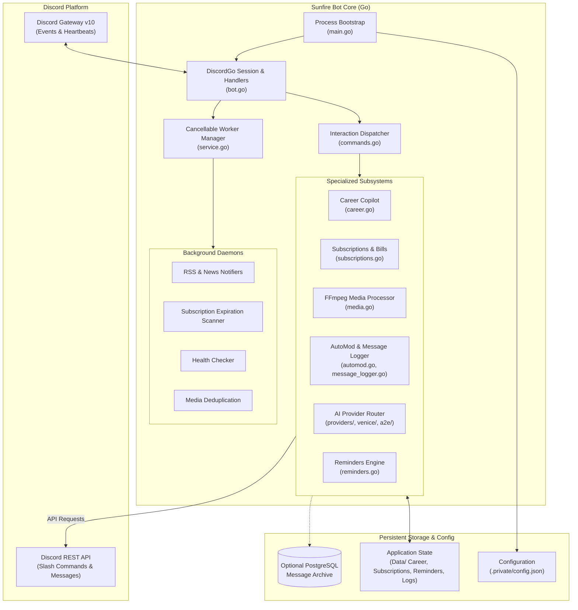

# Sunfire

[](https://golang.org/)
[](https://github.com/bwmarrin/discordgo)
[](#linux-systemd-deployment)
[](#runtime-profile)
[](LICENSE)

**Sunfire** is the personal, high-performance Discord bot engineered for the dedicated Sunfire server (`1557930395868209162`). Implemented in Go using `discordgo`, it integrates advanced server moderation, slash-command automation, multi-tier AI provider access, scheduled notifier daemons, career copilot pipelines, financial subscription tracking, and deep operational telemetry.

---

## Project Documentation

- [Agent Guidelines](AGENTS.md) — Operational guidelines, mandatory GPG commit signing, and Go toolchain standards.
- [Active Task Handoff](HANDOFF.md) — Current operational status, active systemd service state, and immediate next steps.
- [Project Roadmap](ROADMAP.md) — Architectural phases, planned configuration unification, and future web dashboard tooling.

---

## Runtime Profile

The bot is tightly scoped to a single operational environment and a dedicated Discord guild:
- **Primary Guild:** `1557930395868209162`
- **Bot Owner:** Daniel Kill (`daniel@danielkill.online`)
- **Runtime Model:** Long-lived Discord Gateway v10 client with cancellable background workers and graceful shutdown.
- **Secrets Management:** Root config loads from `.private/config.json` by default or `SUNFIRE_CONFIG_FILE`.
- **System Supervision:** Actively running as a systemd user service (`~/.config/systemd/user/sunfire.service`) on `DANIELPREDPC` (WSL2), with hardened system-level unit in `deploy/`.
- **Logging:** Structured logging to stdout/stderr captured by journald, alongside an optional real-time Discord moderation channel.

---

## High-Level Architecture



Startup is linear, explicit, and deterministic:
1. `main.go` resolves credentials from `SUNFIRE_CONFIG_FILE` or `.private/config.json`.
2. `a2e.Init()`, `venice.Init()`, and `providers.Init()` initialize integration packages.
3. `buildCommandSpecs()` populates all slash-command definitions.
4. `NewBot(token)` creates the `discordgo` session and binds event handlers.
5. `bot.Open()` connects to the Discord Gateway; `onReady()` registers guild commands and starts background workers.
6. `main.go` awaits `SIGINT` or `SIGTERM`, cancels workers with a 10-second drain timeout, and closes the session cleanly.

---

## Featured Subsystems & Command Catalog

### 1. Career Copilot (`career.go`)
An end-to-end career management and job search suite:
- **Application Tracking:** `/career track <org> <position> [url] [status] [notes] [followup]`, `/career list`, `/career update`, `/career stats`, `/career export` (exports to structured JSON).
- **AI Fit Analysis & ATS Matching:** `/career analyze` and `/career match` evaluate alignment against Daniel Kill's authoritative resume using native PDF text extraction (`Resume.pdf`), uploaded PDF/Markdown attachments, or local files, identifying strengths, ATS keywords, and interview angles.
- **Cover Letter Drafting:** `/career cover-letter <org> <role> [description]` drafts customized, professional cover letters.
- **Certification Roadmap:** `/career certs [status]` tracks industry credentials (AWS, CompTIA, Linux Foundation) with direct study links and priority tiers.
- **Action Checklist & Daily Briefings:** `/career checklist` tracks administrative milestones; `/career followups` lists overdue application follow-ups.
- **Persistence:** Stored under `Data/Career/` (`applications.json`, `checklist.json`, `certifications.json`).

### 2. Subscriptions & Recurring Bills (`subscriptions.go`)
Financial oversight and automated renewal alert daemon:
- **Command Suite:** `/subscriptions list`, `/subscriptions add`, `/subscriptions modify`, `/subscriptions delete`, `/subscriptions renew`, `/subscriptions stats` (monthly burn rate and category breakdown), `/subscriptions upcoming` (30-day forecast), `/subscriptions test-alert`.
- **Hourly Expiration Daemon:** Continuously checks active subscriptions and dispatches direct messages to the owner within 7 days of renewal.
- **Interactive Action Buttons:** Direct Message alerts include interactive Discord buttons (`[✅ Mark as Renewed]`, `[🛑 Cancelled]`) for 1-click renewal advancement.
- **Persistence:** Stored under `Data/Subscriptions/subscriptions.json`.

### 3. Media Processing Suite (`media.go`, `media_downloader.go`)
- `/media transform file:<attachment>` downloads audio, image, or video attachments and presents an interactive private picker with up to **25 FFmpeg transformations**.
- `/media download url:<url> [format:video|audio]` ingests streams and clips from YouTube, Twitch, Twitter/X, and 1,000+ sites via `yt-dlp` and FFmpeg with automatic 25 MiB Discord compression.
- **Supported Operations:** Lossless PNG/H.264 optimization, dimension scaling (width/height), audio extraction, audio normalization (LUFS), video-to-GIF conversion, format transcoding (MP4, WebM, MKV, MP3, WAV, FLAC, Opus).
- **Constraints:** Input/output files capped at 25 MiB; temporary artifacts auto-deleted after 15 minutes. Requires `ffmpeg` and `yt-dlp` on host.

### 4. Multi-Provider AI Architecture (`providers/`, `venice/`, `a2e/`)
- **Venice AI Suite:** `/venice music` (music synthesis via `minimax-music-v26` with cost quoting and automatic audio cleanup), image generation, chat, and transcription.
- **OpenRouter & LLM Gateways:** Multi-provider inference across Groq, Gemini, DeepSeek, and Mistral with streaming and rate-limit backoff.
- **A2E Integration:** Automated audio processing and task-polling integration.

### 5. Host Fleet & DevOps Management (`docker_manager.go`, `fleet_manager.go`, `sysinfo.go`)
- **Docker Fleet & Container Manager (`/docker`):** Ephemeral admin command inspecting host container health (`/docker status`), lifecycle control (`/docker start`, `/docker stop`, `/docker restart`), and tailing container logs (`/docker logs <container> [lines]`).
- **Git Fleet Health Monitor (`/fleet`):** Multi-repo monitor scanning all active repositories in `/home/daniel/Repos/` (`/fleet status`), tracking active branches, uncommitted dirty files, and unpushed commits ahead of origin. `/fleet repo <name>` displays detailed branch remotes and recent commits with GPG signature verification badges (`🔐 GPG`, `❌ Bad Sig`, `⚪ Unsigned`).
- **NVIDIA GPU & Thermal Telemetry (`/sysinfo`):** Live telemetry integration querying `nvidia-smi` for dedicated GPU model, VRAM utilization (MB and %), GPU thermals (°C), and core compute load (%).

### 6. High-Speed Log Analytics & Search (`log_analytics.go`, `message_log.go`)
- **DuckDB SQL Engine (`/message-log query`):** High-speed in-process analytical queries executed against JSON message logs with box-table formatting.
- **Analytical Presets:** `top_chatters` (most active senders & deletions), `daily_trends` (14-day message volume), `top_channels`, `bot_ratio` (human vs bot percentage), and `longest_messages`.
- **Custom SQL Support:** Validated read-only `SELECT` / `WITH` queries over `FROM logs` with strict rejection of destructive DDL/DML tokens.

### 5. Automated Background Notifiers
Managed via `service.go` using cancellable goroutines with at-least-once delivery semantics:
- **OpenRouter RSS:** Scrapes and posts newly released AI models to designated notification channels.
- **YouTube & Kick:** Polling video uploads and livestream transitions (including offline edit states).
- **Freebies & Deals:** Scrapes and alerts on game giveaways (Epic Games, Steam).
- **Movies & Media:** Tracking theatrical/digital releases.
- **Birthdays & Hermes Tips:** Automated community announcements and LLM tips.

### 6. Moderation, AutoMod & Message Logging
- **AutoMod Engine (`automod.go`):** Case-insensitive substring matching against banned phrases. Deletes violations, logs trigger events with message context under `Data/AutoModEvents/<guild-id>/<user-id>.jsonl`, and notifies moderators.
- **Local & PostgreSQL Message Logging (`message_logger.go`, `message_log.go`):** Complete message and media audit trails written locally to `Data/` with optional search and statistics querying via PostgreSQL (`/message-log stats`).
- **Access Control (`command_access.go`):** Fine-grained permission model distinguishing public commands from owner-only and grantable restricted commands (`Data/commandAccess.json`).

---

## Repository Structure

```text
Sunfire/
├── a2e/                            # A2E audio generation & task polling integration
├── deploy/                         # Production systemd deployment templates
│   └── sunfire.service             # Example hardened systemd service unit
├── modules/                        # Reusable Go modules (chat, image, video, audio, models)
├── providers/                      # Provider abstraction layer for external AI APIs
├── venice/                         # Venice AI chat, music, and image integration
├── Data/                           # Persistent state directory (git-ignored)
│   ├── AutoMod/                    # Guild AutoMod rules & configurations
│   ├── AutoModEvents/              # User-specific violation JSONL logs
│   ├── Career/                     # Job applications, action checklist, certifications
│   ├── Subscriptions/              # Active subscriptions and renewal state
│   ├── Reminders/                  # Scheduled reminder definitions
│   └── NotifierCaches/             # Upstream RSS/notification delivery deduplication caches
├── .private/                       # Local uncommitted secrets (git-ignored)
│   └── config.json                 # Bot token, provider keys, and channel bindings
├── data_pruner.go                  # Automated rolling retention, gzip archiving, and media pruning daemon
├── automod.go                      # AutoMod banned phrases, scanning, and event logging
├── bot.go                          # DiscordGo session management, event routing, worker lifecycle
├── career.go                       # Career Copilot suite (tracking, AI fit analysis, certs)
├── commands.go                     # Slash-command specs, composition, and central dispatch
├── config.go                       # Configuration structures, environment resolution, and defaults
├── health_checker.go               # Periodic external URL probing daemon
├── main.go                         # Process bootstrap, signal trapping, and graceful teardown
├── media.go                        # Interactive FFmpeg media transformation picker
├── media_logger.go                 # Attachment and media link archiving
├── message_log.go                  # PostgreSQL message archive querying & stats
├── message_logger.go               # Local JSONL message event recording
├── notifier_*.go                   # External polling daemons (YouTube, Kick, RSS, movies, freebies)
├── reminders.go                    # Recurring and one-shot reminder scheduler
├── service.go                      # Cancellable background worker orchestration
├── setup_test.go                   # Verification suite for /setup workflow and channel idempotency
├── subscriptions.go                # Recurring bill management and 7-day DM alert daemon
├── AGENTS.md                       # Operational rules and agent contract
├── HANDOFF.md                      # Active operational state and task handoff
├── README.md                       # This comprehensive documentation
├── ROADMAP.md                      # Architecture roadmap and milestones
├── go.mod                          # Go module definition (Go 1.26+)
└── go.sum                          # Cryptographic dependency checksums
```

---

## Configuration & Environment

Configuration resolves hierarchically in `config.go`:
1. Path specified by `SUNFIRE_CONFIG_FILE`
2. `.private/config.json` relative to `SUNFIRE_HOME`
3. Fallback to `BOT_TOKEN` environment variable

### Environment Variables
- `SUNFIRE_HOME`: Application root directory (defaults to current working directory).
- `SUNFIRE_DATA_DIR`: Writable persistent state directory (defaults to `$SUNFIRE_HOME/Data`).
- `SUNFIRE_CONFIG_FILE`: Path to JSON configuration file (defaults to `$SUNFIRE_HOME/.private/config.json`).
- `SUNFIRE_HERMES_BIN`: Optional absolute path to Hermes executable.

---

## Development & Verification

### Running Tests in WSL2
Execute Go tests using the native Linux Go toolchain in WSL:

```bash
# Run all package unit tests
wsl.exe -d daniel-kill -e bash -c "cd /home/daniel/Repos/Sunfire && /usr/local/go/bin/go test ./..."

# Run tests with race detector
wsl.exe -d daniel-kill -e bash -c "cd /home/daniel/Repos/Sunfire && /usr/local/go/bin/go test -race ./..."

# Compile binary
wsl.exe -d daniel-kill -e bash -c "cd /home/daniel/Repos/Sunfire && /usr/local/go/bin/go build -o Sunfire ."
```

---

## Server Infrastructure Workflow (`/setup`)

The `/setup` slash command prepares and audits the standard Sunfire Discord server category and channel topology:

1. **Private Sunfire Category (`Sunfire`):**
   - Restricted to server staff (`@everyone` denied View and Send).
   - `#chats`: Private staff text channel.
   - `#logs`: Real-time system, moderation, and event logging (`loggingChannelId`).
2. **Read-Only Information Category (`INFO`):**
   - Public view, read-only (`@everyone` denied Send/Threads/Reactions).
   - `#rules`: Pinned server rules, community guidelines, and Discord ToS embed.
3. **Read-Only Feeds & Media Category (`Feeds & Media`):**
   - Automatically provisions dedicated notification channels with service topics:
     - `#youtube`: YouTube channel uploads and alerts.
     - `#spotify`: Track, playlist, and artist updates.
     - `#movies`: TMDB theatrical and streaming releases.
     - `#free-stuff`: GG.deals free game drops and discounts.
     - `#kick-streams`: Live stream alerts.
     - `#nist`: National Vulnerability Database CVE alerts ([nvd.nist.gov](https://nvd.nist.gov/)).

> **Idempotent Channel Audit:** If `/setup` is executed again, it inspects existing guild channels (`AuditSetupWorkflow`), preserves existing channels without duplicate creation, and automatically provisions any missing channels from the workflow.

---

## Production Deployment (Systemd User Service)

Sunfire runs continuously as a **systemd user service** on `DANIELPREDPC` (WSL2):

### User Service Unit (`~/.config/systemd/user/sunfire.service`)
```ini
[Unit]
Description=Sunfire Discord Bot
After=network-online.target
Wants=network-online.target

[Service]
Type=simple
WorkingDirectory=/home/daniel/Repos/Sunfire
Environment=SUNFIRE_HOME=/home/daniel/Repos/Sunfire
Environment=SUNFIRE_CONFIG_FILE=/home/daniel/Repos/Sunfire/.private/config.json
ExecStart=/home/daniel/Repos/Sunfire/Sunfire
Restart=on-failure
RestartSec=5s
TimeoutStopSec=15s
KillSignal=SIGTERM
UMask=0077
StandardOutput=journal
StandardError=journal

[Install]
WantedBy=default.target
```

### Management Commands
```bash
# Reload user daemon
systemctl --user daemon-reload

# Restart service after code changes
systemctl --user restart sunfire.service

# Inspect live status
systemctl --user status sunfire.service

# Follow live output logs
journalctl --user -u sunfire.service -f
```

---

## 📜 License

Private and proprietary © [Daniel Kill](https://github.com/daniel-kill) (`daniel@danielkill.online`). All rights reserved.
